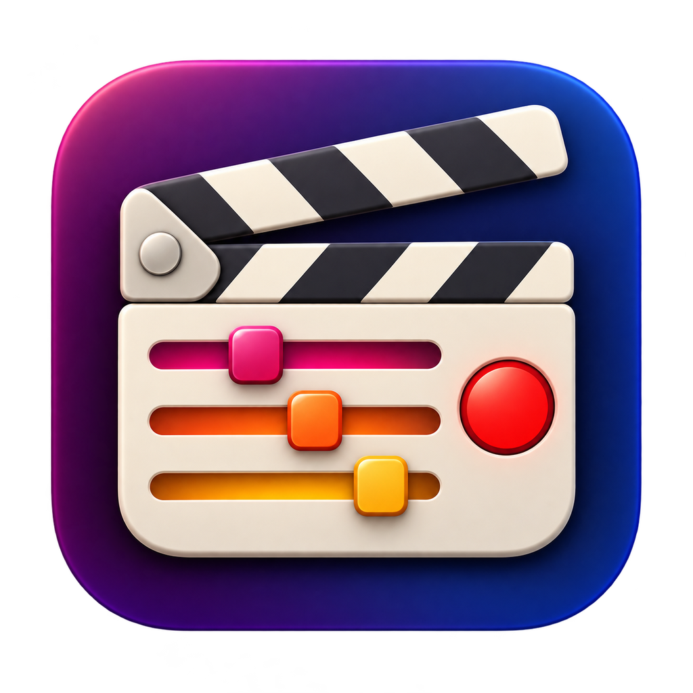
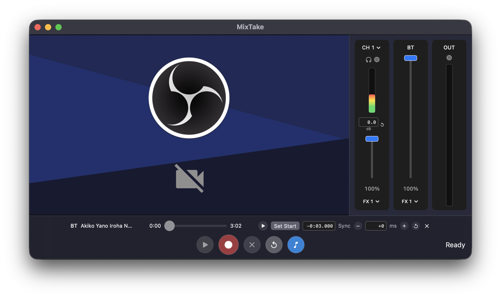

<p align="center">
  
</p>

<h1 align="center">MixTake</h1>

<p align="center">
  <a href="https://github.com/jdel/MixTake/actions/workflows/release.yml"></a>
  <a href="https://github.com/jdel/MixTake/releases/latest"></a>
</p>

MixTake is a compact audiovisual recorder for macOS. Record a camera with the
channels you choose from a Core Audio interface, add a backing track, monitor
levels, and export a finished video or separate files for editing.

> Disclaimer: This is the only thing written by a human in this project

## Features

- Camera recording with multichannel audio
- Independent mixer controls, meters, and clip indicators
- Live monitoring and up to three Audio Unit effects per channel
- Backing tracks with adjustable start time and synchronization
- MP4, mixed audio, and separate-track exports
- Saved sessions and reusable channel presets



## Getting started

MixTake requires an Apple Silicon Mac running macOS 15 or later.

Install with Homebrew:

```sh
brew install --cask jdel/tap/mixtake
```

Alternatively, open the
[latest release](https://github.com/jdel/MixTake/releases/latest),
download the macOS ZIP archive, extract it, and move **MixTake.app** to
**Applications**.

If macOS blocks the downloaded app, remove its quarantine attribute and open it
again:

```sh
xattr -dr com.apple.quarantine /Applications/MixTake.app
```

Only do this for MixTake downloaded from the release page above.

On first launch, allow camera and microphone access. Open **Settings** with
`Command-,` to choose your camera, audio input, audio output, and active input
channels.

## Keyboard shortcuts

| Shortcut | Action |
| --- | --- |
| `Space` | Record, stop, play, or pause |
| `Delete` | Retake |
| `R` | Reset |
| `Command-B` | Add or show the backing track |
| `Command-O` | Open a session |
| `Command-S` | Save |
| `Command-Shift-E` | Export video mix |
| `Command-Shift-A` | Export audio mix |
| `Command-Shift-T` | Export separate tracks |
| `Command-?` | Show all shortcuts |

## License

[BSD 2-Clause](LICENSE)
